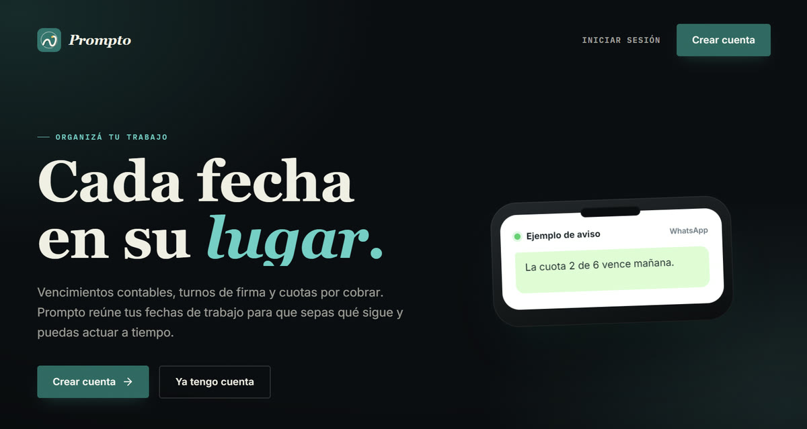

**Desarrollador full stack · Full-stack developer** — Paraguay 🇵🇾

*Construyo software que trabaja mientras no mirás: avisa a tiempo, se actualiza solo y no estorba.*
*I build software that works while you're not looking: it reminds you on time, updates itself and stays out of the way.*

---

### 🇵🇾 Sobre mí

Me gusta hacer el recorrido completo: de la idea a la app que alguien usa todos los días, pasando por el backend, la base de datos y el servidor donde todo corre. Hago apps de escritorio para Windows, apps móviles con Flutter y sistemas web con React y Spring Boot.

Lo que más me importa son los detalles que se sienten: una animación que va fluida a 240 Hz, un widget que gasta casi nada de CPU, un aviso que llega justo antes de que sea tarde.

### 🌎 About me

I like owning the whole path: from an idea to an app someone uses every day, including the backend, the database and the server it runs on. I build Windows desktop apps, Flutter mobile apps and web systems with React and Spring Boot.

What I care about most are the details you can feel: an animation that stays smooth at 240 Hz, a widget that barely touches the CPU, a reminder that arrives right before it's too late.

---

### 🚀 Proyectos / Projects

<table>
<tr>
<td width="50%" valign="top">

#### ✨ [Prompto](https://app-prompto.com)

Agenda y recordatorios para profesionales y negocios: vencimientos tributarios, timbrados, turnos de firma electrónica y cobros a crédito. Avisa **por WhatsApp** a vos y a tu cliente, desde tu propio número, antes de que sea tarde. Tus clientes eligen horario con un link privado.

*Reminders & scheduling SaaS for accountants and small businesses: tax deadlines, e-signature appointments and installment collections, with automatic WhatsApp notifications to both the business and its clients.*

`React` `TypeScript` `Vite` `Spring Boot` `MySQL` `JWT` `WhatsApp API` `Nginx`

</td>
<td width="50%" valign="top">

#### 🪺 [Nido](https://nido.serfley.com)

Un escritorio nuevo para Windows: carpetas que se expanden en el lugar, caja de selección con hilos de luz, widgets de Spotify y estado del equipo, y actualizaciones automáticas.

*A desktop replacement for Windows: in-place expandable folders, an animated selection box, Spotify and system-monitor widgets, and silent auto-updates.*

`C#` `.NET 9` `WPF` `Win32` `Velopack`

**[🌐 nido.serfley.com](https://nido.serfley.com)** · **[⬇️ Descargar / Download](https://github.com/JOFLEY/nido-releases/releases/latest/download/Nido-win-Setup.exe)**

</td>
</tr>
<tr>
<td colspan="2" valign="top">

#### 💸 Gastos
App personal de gastos, ingresos y balance mensual, para el celular y la web. · *Personal finance app: expenses, income and monthly balance, on mobile and web.*

`Flutter` `Dart` `TypeScript`

</td>
</tr>
</table>

Algunos proyectos son privados; con gusto los muestro si te interesan. · Some projects are private; happy to walk you through them.

---

### 🧰 Con qué trabajo / Tech stack

 

 

---

### 🛠️ En qué estoy trabajando / What I'm up to

<!--ACTIVIDAD:inicio-->
- 🪺 Nido **v0.3.0** publicado · [15 oct 2026](https://github.com/JOFLEY/nido-releases/releases/tag/v0.3.0)
- 🪺 Nido **v0.2.0** publicado · [14 oct 2026](https://github.com/JOFLEY/nido-releases/releases/tag/v0.2.0)
- 🪺 Nido **v0.1.2** publicado · [13 oct 2026](https://github.com/JOFLEY/nido-releases/releases/tag/v0.1.2)
- 🔨 Cambios en [nido-releases](https://github.com/JOFLEY/nido-releases) · 19 oct 2026
<!--ACTIVIDAD:fin-->

Se actualiza solo cada 6 horas. · Updates itself every 6 hours.

---

<picture>
  <source media="(prefers-color-scheme: dark)" srcset="https://raw.githubusercontent.com/JOFLEY/JOFLEY/output/serpiente-oscura.svg" />
  <source media="(prefers-color-scheme: light)" srcset="https://raw.githubusercontent.com/JOFLEY/JOFLEY/output/serpiente.svg" />
  
</picture>

📫 **¿Un proyecto en mente? · Got a project in mind?** → [jofleyns@gmail.com](mailto:jofleyns@gmail.com)

